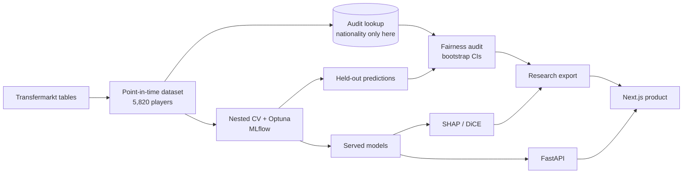

# FairValue

**A nationality-blind model of football transfer values, and an audit of who it gets wrong.**

FairValue predicts a player's Transfermarkt market value from match performance, profile and club
context, then asks a harder question: do the model's errors fall differently on UEFA and non-UEFA
nationals, when nationality never enters the model? The research design was pre-registered before
any model was trained, every reported figure comes from held-out predictions, and the whole pipeline
regenerates from one script. A Next.js product puts the models, explanations and audit in front of
people who will never open a notebook.

**Live preview:** [fairvalue-web-111067737818.asia-south1.run.app](https://fairvalue-web-111067737818.asia-south1.run.app)
(reviewers only: password-protected and not indexed; ask the author for access. The first page after
a quiet spell can take a few seconds while the service wakes.)

---

## The finding

Across 5,820 players at clubs in 14 European first divisions, **non-UEFA players are valued higher by
the market than a nationality-blind model predicts, relative to UEFA players in the same leagues.**

| | Model A (with league and club context) | Model B (performance and profile only) |
|---|---|---|
| Held-out log R² | **0.891** | 0.669 |
| Typical error (median, EUR) | €0.62M | €1.06M |
| Signed gap, non-UEFA − UEFA, league-stratified (log) | **+0.093** (95% CI 0.063 to 0.124) | +0.164 (0.121 to 0.207) |
| Accuracy gap (MAE, league-stratified) | +0.012 (−0.008 to 0.031) | −0.009 (−0.039 to 0.022) |

- **Equal accuracy, unequal direction.** The model is about as accurate for both groups, but it
  under-predicts non-UEFA players and slightly over-predicts UEFA players. Under Model A that is
  about 10% in relative terms, and non-UEFA players are placed below their true value tier
  3.3 percentage points more often (CI 1.3 to 5.4).
- **The opposite of the starting hypothesis**, which expected non-UEFA players to be valued *lower*.
- **It holds up.** The gap is positive in all ten deciles of the model's own prediction, for every
  algorithm tried (+0.093 to +0.134), at a 900-minute threshold (+0.084), for clubs the model has
  never seen (+0.112), and with club-clustered intervals (0.061 to 0.125).
- **It is not uniform.** The gap is concentrated in Russia (+0.264), Türkiye (+0.257), Greece,
  Ukraine and Belgium. In England, Italy, France, Portugal and Germany it is close to zero, with
  intervals that span zero.
- **Context dominates.** Removing league identity and club strength drops R² from 0.891 to 0.669: where
  a player plays explains much of what they are worth, beyond how they play.

### How to read it
This is an **association within a selected population**, not evidence of discrimination and not a
causal effect of nationality. Player-level match data exists only for these 14 leagues, and the
coverage filter removes 79% of non-UEFA players against 47% of UEFA players, so this population is
not the global market. The target itself, Transfermarkt's community valuation, may carry bias, which
a model trained to reproduce it will inherit. The full argument, with every table, is in
[the fairness audit](docs/reports/FAIRNESS_AUDIT.md).

---

## What is in the repository

### Research pipeline (`src/`)
| Stage | What it does |
|---|---|
| **Data** | Builds a point-in-time dataset from the Transfermarkt tables: features use only matches before each player's own valuation date, so nothing leaks from the future. Quality checks and a coverage audit of who survives each filter. |
| **Locked design** | Population, research questions, models and metrics fixed in [RESEARCH_DESIGN](docs/RESEARCH_DESIGN.md) before training ([D-011](docs/DECISIONS.md)). 53 dated decisions record every change since. |
| **Models** | Ridge, Random Forest and HistGradientBoosting regressors and a four-tier classifier, under 5-fold stratified CV with Optuna tuning nested inside the outer folds. Tracked in MLflow. The primary model was chosen by a rule stated in advance. |
| **Fairness audit** | Signed and absolute error gaps, raw and league-stratified, with 2,000-replicate stratified bootstrap intervals; tier error rates; a Fairlearn cross-check; calibration within predicted-value deciles; club-grouped CV and club-clustered bootstrap as supplementary checks. |
| **Explainability** | SHAP TreeExplainer, globally and per group, with additivity checked to 1e-6; DiCE counterfactuals compared across groups. |
| **Monitoring** | Simulated drift against the previous season (PSI and an Evidently report) and a written retraining policy. |

Nationality, citizenship, confederation, birthplace and national-team data are kept out of every
feature matrix. They live in a separate lookup used only for the audit, and a guard function refuses
to fit any model that sees them.

### Product (`web/`)
A Next.js application over the real models, with three environments and a shared player dossier:

- **Overview**: the Valuation Theatre, where each player is a lane on a log value scale, observed
  value against Model A, followed by the market, the discrepancy and the research.
- **Terminal**: a player explorer with filters, comparison of up to four players, watchlists,
  market and league views, a live valuation studio and the fairness audit.
- **Stories**: long-form research and valuation stories, head-to-heads, and the methods paper.
- **Player dossier**: one canonical page per player, with the valuation journey (an exact SHAP
  waterfall from the live API), Model A against Model B, history and audit context.

Every number on screen is read from generated research outputs or the live API. The web app
computes no research figure of its own.

### Service and operations
- **FastAPI** service: `POST /predict`, `POST /explain` (per-prediction SHAP), `GET /metadata`,
  `GET /health`. The web app reports the model as online only when the served model versions and
  dataset fingerprint match the research registry.
- **Docker** images for the API and the web app; **GitHub Actions** CI runs the Python and web
  suites, builds the web app, and retrains on a reproducible 20% subset as a regression gate.
- **Tests:** 138 Python (unit tests on synthetic data, plus data and leakage tests on the real
  build) and 181 web.
- Deployed as a private, password-protected preview on Google Cloud Run (scale to zero, private
  API behind identity tokens, not indexed). See [DEPLOYMENT](docs/DEPLOYMENT.md).

---

## Architecture



---

## Reproduce

Python 3.12. Commands are for Windows; on macOS or Linux use `.venv/bin/python`.

```bash
python -m venv .venv
./.venv/Scripts/python -m pip install -r requirements.txt
./.venv/Scripts/python -m src.data.acquire          # raw tables (~113 MB), checksums verified
./.venv/Scripts/python -m src.data.build_dataset    # processed dataset
./.venv/Scripts/python -m src.models.train          # nested CV, ~20 min
./.venv/Scripts/python -m src.fairness.audit        # fairness audit on held-out predictions
./.venv/Scripts/python -m pytest -q
```

`scripts/run_pipeline.sh` regenerates every reported result in order. Browse experiments with
`python -m mlflow ui --backend-store-uri mlruns`.

Run the product locally (needs the trained `models/*.joblib`):

```bash
docker compose up --build        # API on :8000, web on :3000
```

---

## Documentation

| | |
|---|---|
| [Research design](docs/RESEARCH_DESIGN.md) | Population, research questions, models and metrics (locked) |
| [Fairness audit](docs/reports/FAIRNESS_AUDIT.md) | The primary results, robustness and per-league detail |
| [Model evaluation](docs/reports/MODEL_EVALUATION.md) | Accuracy by algorithm, position, tier, minutes and league |
| [Supplementary checks](docs/reports/SUPPLEMENTARY_CHECKS.md) | Unseen clubs and within-club dependence |
| [Explainability](docs/reports/EXPLAINABILITY.md) | SHAP and DiCE |
| [Coverage audit](docs/reports/COVERAGE_AUDIT.md) | Who the data covers, and who it loses |
| [Model card](docs/MODEL_CARD.md) · [Data card](docs/DATA_CARD.md) | Intended use, limits, provenance |
| [Known limitations](docs/KNOWN_LIMITATIONS.md) | Biases and caveats |
| [EU AI Act assessment](docs/EU_AI_ACT_ASSESSMENT.md) | Risk classification (not legal advice) |
| [Decisions](docs/DECISIONS.md) · [Changelog](docs/CHANGELOG.md) | Why things are the way they are |
| [Product](docs/PRODUCT.md) · [Deployment](docs/DEPLOYMENT.md) · [Monitoring](docs/MONITORING.md) | The web app, hosting and drift policy |

---

## Data and rights

Match and valuation data come from
[dcaribou/transfermarkt-datasets](https://github.com/dcaribou/transfermarkt-datasets) (CC0 repository,
scraped from Transfermarkt; upstream updates paused, valuations to 12 June 2026). Raw data is not
redistributed here. Transfermarkt's own terms have not been reviewed, so the licensing of the
underlying content is uncertain; see the [data card](docs/DATA_CARD.md). Player portraits and their
terms are listed on the site's credits page. Unlicensed images are not committed to this repository.
No open-source licence has been chosen for the code yet.

FairValue is research software. Its estimates reproduce a community valuation for a selected
population and are not financial, scouting or transfer advice.

**Author:** Mohak Mandwani.
