<div align="center">


**A nationality-blind model of football transfer values, and an audit of who it gets wrong.**

[The finding](#the-finding) · [Explore the product](#explore-the-product) · [How it works](#how-it-works) · [Reproduce](#reproduce-the-research) · [Documentation](#documentation)

</div>

<br>

FairValue predicts a player's Transfermarkt market value from match performance, profile and club
context, **without ever seeing nationality**. It then asks a question that accuracy alone cannot
answer: do the model's *errors* fall differently on UEFA and non-UEFA players?

They do, and not in the direction first hypothesised. Within the selected leagues, **non-UEFA
players are valued higher by the market than the model predicts, relative to UEFA players**, even
though the model is about equally accurate for both groups.

<p align="center">
  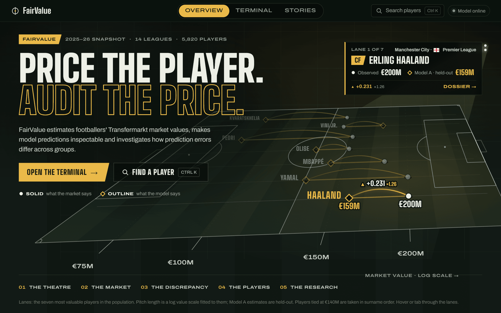
</p>

> **Live:** [fairvalue.web.app](https://fairvalue.web.app), on Google Cloud Run behind Firebase Hosting.
> It scales to zero when idle, so the first page after a quiet spell can take a few seconds while the
> service wakes.
> The code is MIT-licensed; data and images keep their own terms (see [Licence](#data-licensing-and-limits)).

---

## The finding

The research population is **5,820 players** at clubs in **14 European first divisions**, valued
between June 2025 and June 2026, with at least 450 club minutes (1,496 non-UEFA, 4,324 UEFA).

<p align="center">
  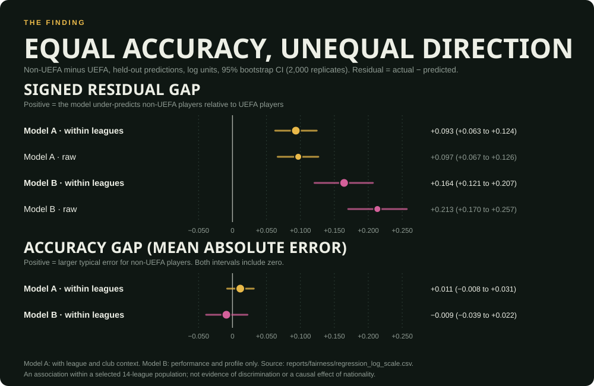
</p>

- **Equal accuracy, unequal direction.** Typical error is about the same for both groups (the
  accuracy-gap intervals include zero), but the model **under-predicts non-UEFA players and slightly
  over-predicts UEFA players**. Under Model A the signed gap is **+0.093** log units, about +10% in
  relative terms. The tier classifier places non-UEFA players *below* their true value tier 3.3
  percentage points more often (95% CI 1.3 to 5.4).
- **The opposite of the starting hypothesis**, which expected non-UEFA players to be valued
  *lower* than comparable UEFA players.
- **It holds up.** The league-stratified gap is positive in all ten deciles of the model's own
  prediction, for every algorithm tried (+0.093 to +0.134), at a 900-minute threshold (+0.084),
  for clubs the model has never seen (+0.112) and with club-clustered intervals (0.061 to 0.125).
- **It is not uniform.** It is concentrated in Russia (+0.264), Türkiye (+0.257), Greece, Ukraine and
  Belgium. In England, Italy, France, Portugal and Germany it is close to zero, with intervals that
  span zero.

### How to read it

Predictive accuracy and directional bias are different things: a model can be equally accurate for
two groups and still miss one of them in a consistent direction.

This is an **association within a selected population**, not evidence of discrimination and not a
causal effect of nationality. Two caveats matter most:

1. **The population is selected.** Player-level match data exists only for these 14 leagues, and the
   coverage filter removes 79% of currently valued non-UEFA players against 47% of UEFA players. It
   is not the global market.
2. **The target may itself be biased.** The model reproduces Transfermarkt's community valuations.
   If those carry bias, a model trained on them inherits it.

<p align="center">
  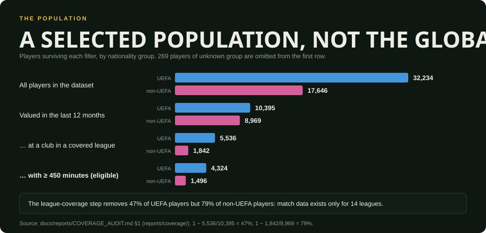
</p>

The full argument, every table and the limits specific to the audit are in the
[fairness audit](docs/reports/FAIRNESS_AUDIT.md).

---

## Explore the product

FairValue is a Next.js application over the real models and generated research outputs. It has three
environments and one shared player page. Every number on screen is read from a generated research
output or the live API; the web app computes no research figure of its own.

### Overview: the Valuation Theatre

Each player is a lane on a log value scale: the solid dot is what the market says, the outline is
what the held-out model estimated. Below the theatre, the page walks from the market to the
discrepancy and the research.

<p align="center">
  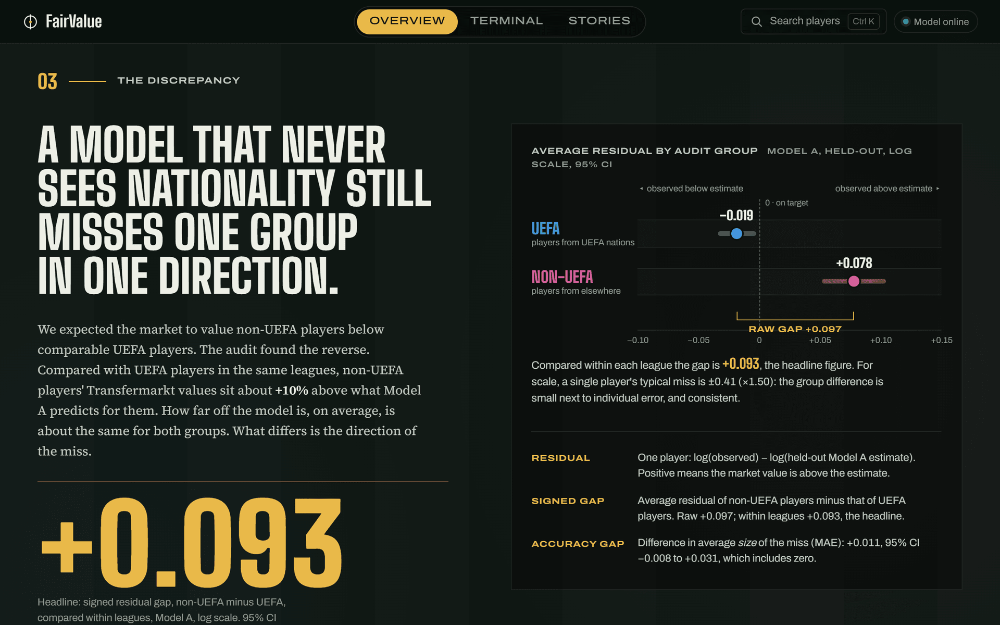
</p>

### Player dossier and valuation journey

One canonical page per player: the observed value, Model A and Model B held-out estimates, and
profile. The valuation journey is an exact SHAP waterfall from the **live API**, showing which inputs
raised or lowered the estimate. It explains the *served* model, which was refit on all players,
so its figure differs from the held-out estimate shown beside it, and the page says so.

<p align="center">
  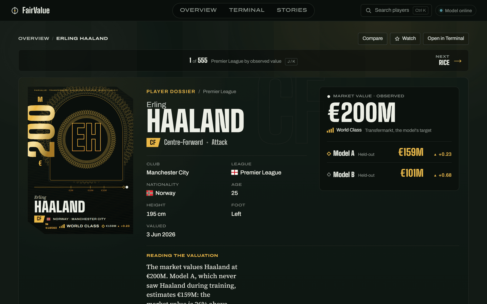
</p>

<p align="center">
  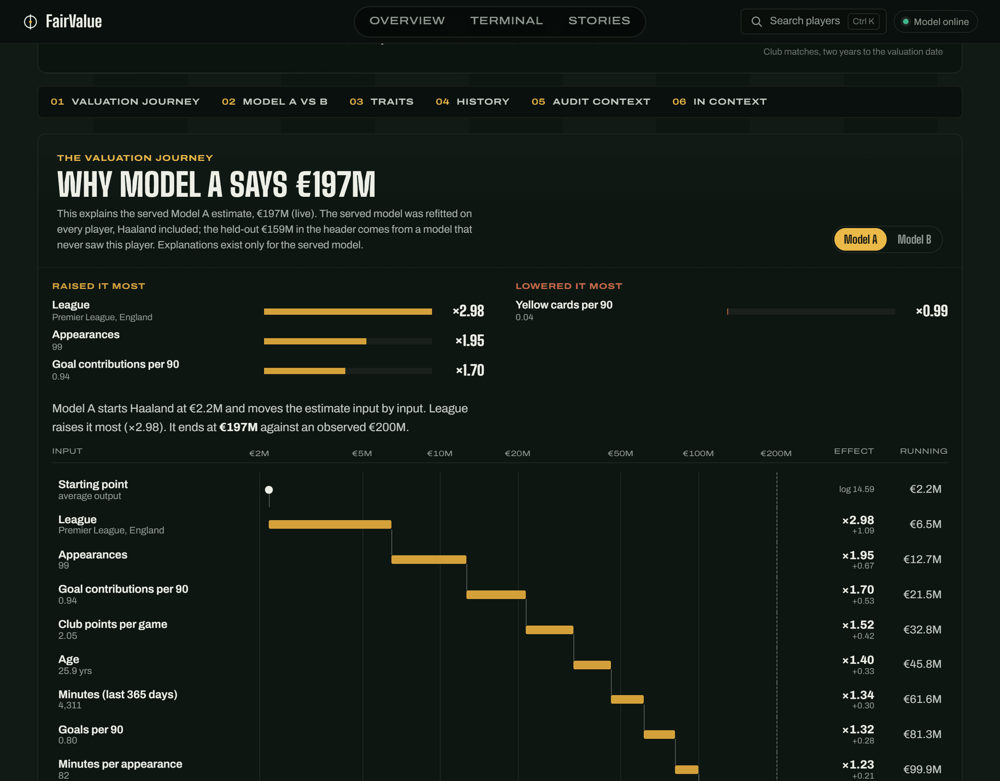
</p>

### Terminal: explore, compare, audit

A working environment for the full population: filters, sortable table, comparison of up to four
players, watchlists, market and league views, a live valuation studio and the interactive fairness
audit.

<p align="center">
  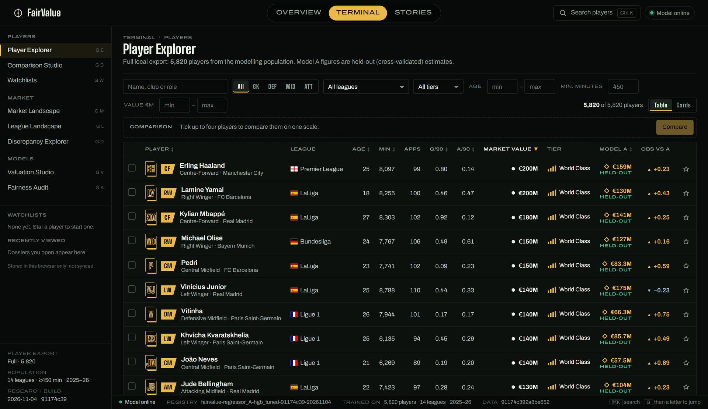
</p>

<p align="center">
  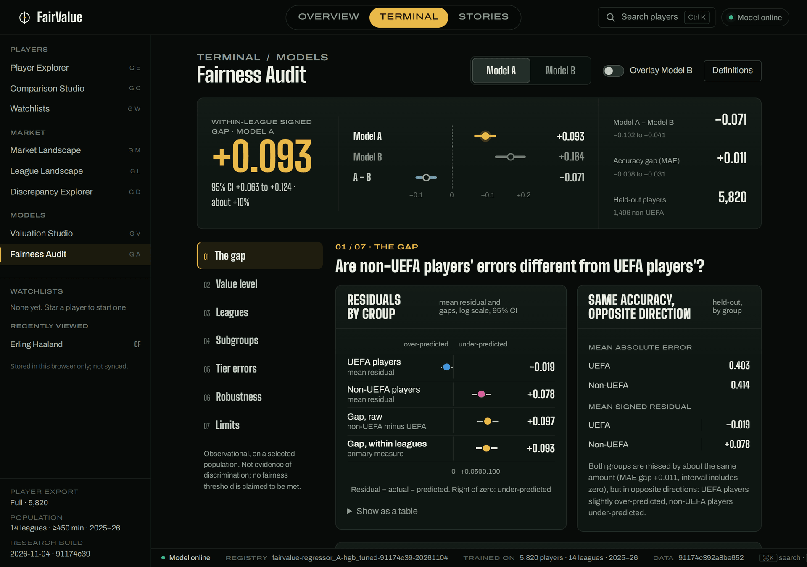
</p>

### Stories

Long-form research and valuation stories, head-to-heads and the methods paper, built from the same
generated outputs.

<p align="center">
  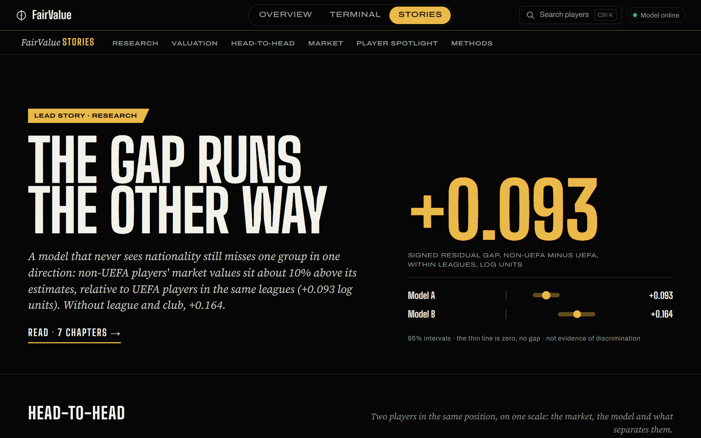
</p>

> **About these screenshots.** They were captured from a production build of this repository's
> `main` branch running locally against the real API, with the full 5,820-player export, which is
> dataset content and is not committed. A fresh clone shows an eight-player showcase instead.
> Player portraits were switched off for the capture; the monograms are the product's fallback.

---

## How it works

<p align="center">
  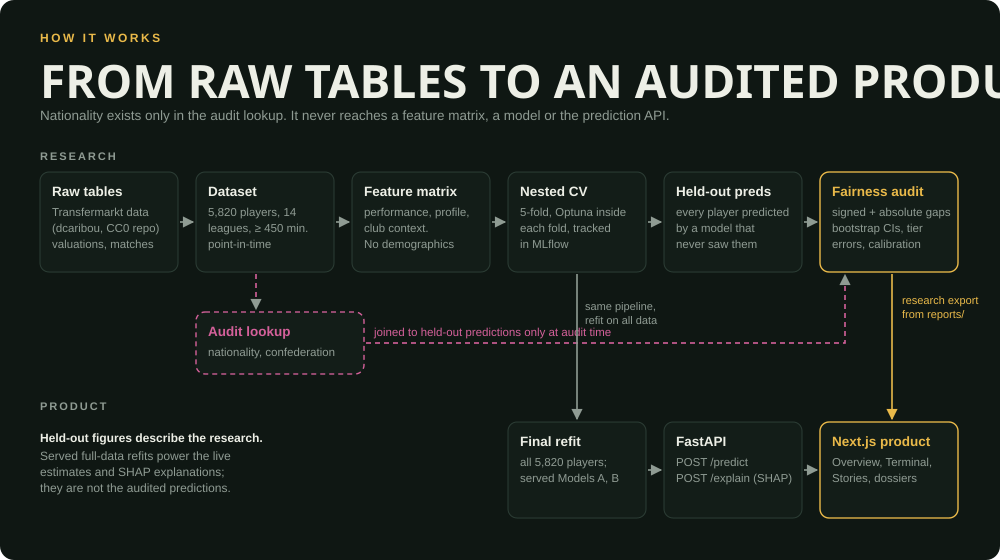
</p>

| Stage | What it does |
|---|---|
| **Data** | Builds a point-in-time dataset from the Transfermarkt tables. Features use only matches before each player's own valuation date, so nothing leaks from the future. Quality checks and a coverage audit show who survives each filter. |
| **Locked design** | Population, research questions, models and metrics were fixed in [RESEARCH_DESIGN](docs/RESEARCH_DESIGN.md) before training ([D-011](docs/DECISIONS.md)). Later changes are recorded as dated decisions. |
| **Models** | Ridge, Random Forest and HistGradientBoosting regressors plus a four-tier classifier, under 5-fold CV stratified on tier, with Optuna tuning nested inside the outer folds. Tracked in MLflow. The primary model was chosen by a rule stated in advance. |
| **Fairness audit** | Signed and absolute error gaps, raw and league-stratified, with 2,000-replicate stratified bootstrap intervals; tier error rates; a Fairlearn cross-check; calibration within predicted-value deciles; club-grouped CV and club-clustered bootstrap. |
| **Explainability** | SHAP (TreeExplainer), globally and per group; DiCE counterfactuals on the tier classifier, which change match statistics only and are compared across groups. |
| **Monitoring** | Simulated drift against the previous season (PSI and an Evidently report) and a written retraining policy. |
| **Service** | FastAPI: `POST /predict`, `POST /explain`, `GET /metadata`, `GET /health`. The web app reports the model as online only when the served model versions and dataset fingerprint match the research registry. |

### Model A and Model B

| | Model A | Model B |
|---|---|---|
| Inputs | Performance, profile **and** league and club context | Performance and profile only |
| Purpose | The primary model: best available prediction | A comparison: how much of the value, and of the gap, depends on where a player plays |
| Held-out log R² (HGB, Optuna) | **0.891** | 0.669 |

Removing league identity and club strength drops R² from 0.891 to 0.669: where a player plays explains
much of what they are worth, beyond how they play. The comparison is descriptive, not a causal
decomposition.

### Why nationality is not a feature

Nationality, citizenship, confederation, audit group, birthplace and national-team data **never enter
a feature matrix**. They live in a separate `audit_lookup` table that is joined to held-out predictions
only when the audit runs. A guard function (`assert_no_demographic_columns`) refuses to fit any model
that sees such a column, and the API rejects unknown fields, so sending `nationality` returns HTTP 422.

This makes the model *nationality-blind*, not *nationality-free*: other inputs, league above all, can
correlate with nationality. That is why the audit measures outcomes rather than assuming fairness from
the inputs.

---

## What makes the analysis credible

- **Locked before training.** Scope, questions and metric definitions are fixed and changes are
  logged. See [RESEARCH_DESIGN](docs/RESEARCH_DESIGN.md).
- **Held-out predictions only.** Every reported metric uses out-of-fold predictions. The audit group
  is never used in splitting, training or tuning, and tuning is nested inside the outer folds.
- **No future leakage.** Features use only matches up to each player's own valuation date. Training
  and cross-validation use only the current snapshot; the previous season is kept for drift
  simulation.
- **Held-out is not the served model.** Research figures come from held-out predictions. The served
  models are refits on all 5,820 players and power live estimates and SHAP explanations. The product
  labels which is which.
- **Robustness is reported, not hidden.** Raw and league-stratified gaps are reported side by side;
  so are every algorithm, the 900-minute population, unseen clubs and club-clustered intervals.
- **Honest limits.** Confidence intervals reflect evaluation-set sampling, not refit variance. The
  target may be biased. No causal claim and no fairness "compliance" claim is made.

---

## Results at a glance

<p align="center">
  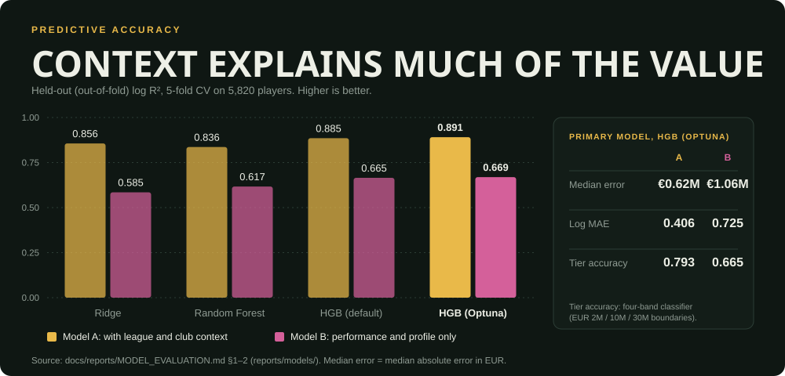
</p>

| Held-out, HGB (Optuna) | Model A | Model B |
|---|---|---|
| Log R² | **0.891** | 0.669 |
| Log MAE | 0.406 | 0.725 |
| Median absolute error (EUR) | €0.62M | €1.06M |
| Tier classifier accuracy | 0.793 | 0.665 |
| Signed gap, non-UEFA − UEFA, **league-stratified** (log) | **+0.093** (0.063 to 0.124) | +0.164 (0.121 to 0.207) |
| Signed gap, non-UEFA − UEFA, **raw** (log) | +0.097 (0.067 to 0.126) | +0.213 (0.170 to 0.257) |
| Accuracy gap (MAE), league-stratified | +0.011 (−0.008 to 0.031) | −0.009 (−0.039 to 0.022) |

Sources: [model evaluation](docs/reports/MODEL_EVALUATION.md) and the
[fairness audit](docs/reports/FAIRNESS_AUDIT.md), generated into `reports/models/` and
`reports/fairness/`. The log scale is primary because EUR averages are dominated by the most
expensive players.

---

## Reproduce the research

**Prerequisites.** Python 3.12 (CI version; `pyproject.toml` allows 3.11+), and for the product Node 20.9+ (CI uses 22). A clean
clone contains **code, documentation and committed report outputs only**. Raw data, processed
datasets, trained `models/*.joblib`, the full player export and MLflow runs are git-ignored and are
regenerated by the steps below.

```bash
git clone https://github.com/17mohak/fairvalue.git && cd fairvalue
python -m venv .venv
```

Commands below use the Windows interpreter path; on macOS or Linux use `./.venv/bin/python`.

```bash
./.venv/Scripts/python -m pip install -r requirements.txt
./.venv/Scripts/python -m src.data.acquire          # raw tables (~113 MB), checksums verified
./.venv/Scripts/python -m src.data.build_dataset    # processed dataset
./.venv/Scripts/python -m src.models.train          # nested CV, ~20 min, held-out predictions + MLflow
./.venv/Scripts/python -m src.models.final          # refit served models on all players
./.venv/Scripts/python -m src.fairness.audit        # fairness audit on held-out predictions
./.venv/Scripts/python -m pytest -q                 # 138 tests; data tests skip without the dataset
```

`bash scripts/run_pipeline.sh` runs the whole sequence in order (about 1.5 hours, including nested
Optuna and DiCE). The data is acquired from a public upstream; its licensing is discussed
[below](#data-licensing-and-limits). Browse experiments with
`python -m mlflow ui --backend-store-uri mlruns`.

**Run the API and the web app.** The API needs the trained models, so run the pipeline (at least
through `src.models.final`) first.

```bash
./.venv/Scripts/python -m uvicorn src.api.app:app --port 8000   # API; docs at /docs
cd web && npm ci && npm run dev                                 # http://localhost:3000
```

Copy `web/.env.example` to `web/.env.local` if the API is not on `127.0.0.1:8000`. Without the
full export the web app shows an eight-player showcase.
`python -m src.product.players` writes the full 5,820-player export (git-ignored: it is dataset
content). To run both services together: `docker compose up --build`. See
[DEPLOYMENT](docs/DEPLOYMENT.md) and [PRODUCT](docs/PRODUCT.md).

**Tests.** 138 Python tests (unit tests on synthetic data, plus data and leakage tests on the real
build) and 181 web tests (`cd web && npm test`). GitHub Actions runs both suites, builds the web
app, and retrains on a reproducible 20% subset as a regression gate.

---

## Documentation

| | |
|---|---|
| [Research design](docs/RESEARCH_DESIGN.md) | Population, questions, models and metrics (locked) |
| [Fairness audit](docs/reports/FAIRNESS_AUDIT.md) | Primary results, robustness and per-league detail |
| [Model evaluation](docs/reports/MODEL_EVALUATION.md) | Accuracy by algorithm, position, tier, minutes and league |
| [Supplementary checks](docs/reports/SUPPLEMENTARY_CHECKS.md) | Unseen clubs and within-club dependence |
| [Explainability](docs/reports/EXPLAINABILITY.md) | SHAP and DiCE |
| [Coverage audit](docs/reports/COVERAGE_AUDIT.md) · [Scope assessment](docs/reports/RESEARCH_SCOPE_ASSESSMENT.md) | Who the data covers, and who it loses |
| [Model card](docs/MODEL_CARD.md) · [Data card](docs/DATA_CARD.md) | Intended use, limits, provenance |
| [Known limitations](docs/KNOWN_LIMITATIONS.md) | Biases and caveats |
| [EU AI Act assessment](docs/EU_AI_ACT_ASSESSMENT.md) | Risk classification (not legal advice) |
| [Product](docs/PRODUCT.md) · [Deployment](docs/DEPLOYMENT.md) · [Monitoring](docs/MONITORING.md) | The web app, hosting and drift policy |
| [Decisions](docs/DECISIONS.md) · [Changelog](docs/CHANGELOG.md) · [Project state](docs/PROJECT_STATE.md) | Why things are the way they are |

Layout: `src/` research and API code · `web/` Next.js product · `reports/` generated outputs ·
`docs/` documentation · `models/` registry (binaries ignored) · `tests/` · `scripts/` · `deploy/`.

---

## Data, licensing and limits

- **Data.** Match and valuation data come from
  [dcaribou/transfermarkt-datasets](https://github.com/dcaribou/transfermarkt-datasets) (a CC0
  repository of data scraped from Transfermarkt; upstream updates are paused, valuations run to 12 June
  2026). Raw data is not redistributed here. **Transfermarkt's own terms have not been reviewed**, so
  the licensing of the underlying content is uncertain. See the [data card](docs/DATA_CARD.md) and
  [provenance](docs/DATA_PROVENANCE.md).
- **Images.** Player portraits and their terms are listed on the product's credits page. Public
  availability of an image does not establish a licence to reuse it; unlicensed images are not committed
  to this repository, and none appear in this README.
- **Code licence.** [MIT](LICENSE), for the source code and documentation written for FairValue. It
  does not cover the data (Transfermarkt-derived, licensing uncertain), the Berlin / WikiPortraits
  portraits (CC BY-SA 4.0, credited per image), the flag icons (their own MIT licence) or third-party
  fonts and packages.
- **Scope.** Findings describe players at clubs in 14 European first divisions, valued June 2025 to June
  2026, and are not the global market. Asian and North American players are barely represented in the
  non-UEFA group (mostly African and South American players in Europe).
- **Use.** FairValue is research software. Its estimates reproduce a community valuation for a
  selected population and are not financial, scouting or transfer advice.

## Credits

- Data: [dcaribou/transfermarkt-datasets](https://github.com/dcaribou/transfermarkt-datasets) and
  Transfermarkt.
- Flags: [flag-icons](https://github.com/lipis/flag-icons) (MIT).
- Libraries: scikit-learn, MLflow, Optuna, Fairlearn, SHAP, DiCE, Evidently, FastAPI, Pydantic, Next.js.
- Typefaces: Big Shoulders Display, Archivo and Source Serif 4.
- Portrait attributions are on the product's `/credits` page.

## Author

Built by **Mohak Mandwani** ([@17mohak](https://github.com/17mohak)). Questions, corrections and
takedown requests: [open an issue](https://github.com/17mohak/fairvalue/issues).
